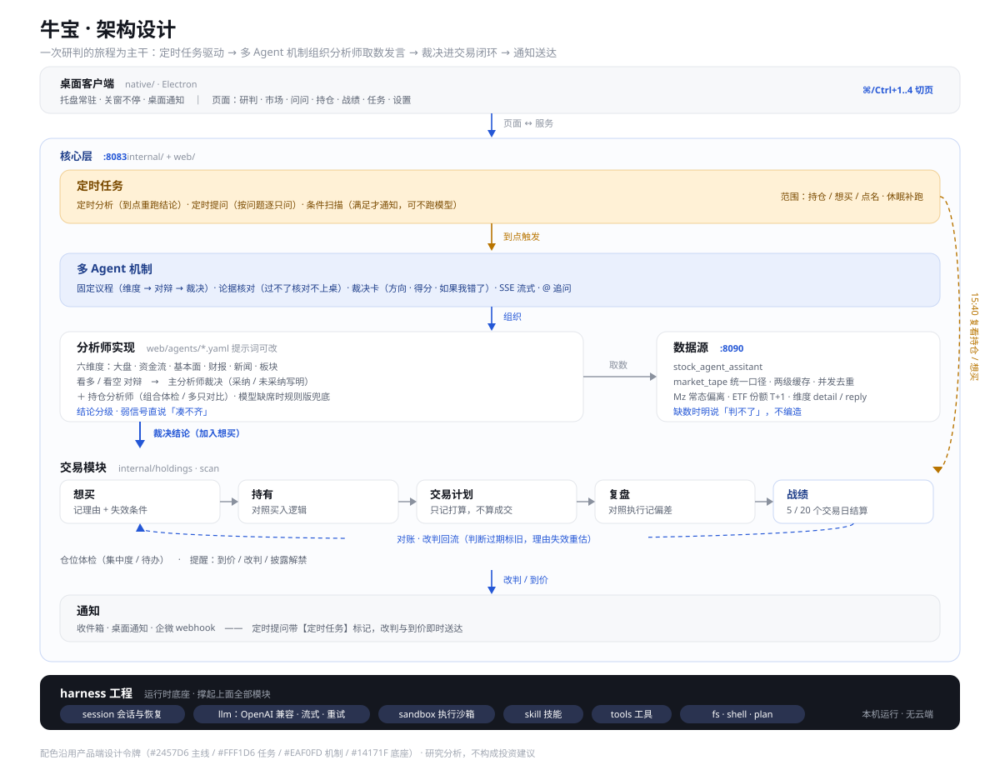

# 牛宝

### 开源的私人投资助理桌面端

__一场可核对的多分析师晨会，一条从研判到想买、持仓、计划、复盘、战绩的完整闭环——人不在的时候，定时任务替你盯。__

__三步装好 ↓__ · __先看它怎么工作 →__ · __提个 Issue →__


---

## 牛宝是什么

牛宝是一个跑在你电脑上的投资研究客户端：默认先看**市场**（钱进没进、国家队在不在、板块轮动、情绪宽度），盯上某只票就进**研判**——六位维度分析师各自取数发言，看多看空当面对辩，主分析师裁决并给条件式提醒。

分析师结论直接落入**想买 / 持仓 / 交易计划**，收盘后由**复盘**和**战绩**对账。每句判断挂着依据按钮，判断过期会标旧。

它不是聊天框，是一套按点上班的工作流：托盘常驻、关窗不停，定时任务在交易日的早午晚替你重跑分析和条件扫描，结果进收件箱和桌面通知。持仓、意图、战绩全部留在本机。

数字不靠模型「记」：行情与基本面等来自 **Tushare**，先经规则算好事实再交给分析师写结论；依据可点开核对，避免聊天框里常见的数据幻觉。


## 三步装好

__1. 拿安装包__

发布页下载，或本地打包（产物在 `native/dist/`）：

```sh
make mac    # 或 make win
```

__2. 首次启动填 Key__

打开设置页，填入你的模型 API Key（OpenAI 兼容接口均可）。macOS 未签名包第一次打开需在 Finder 里右键「打开」。

__3. 走一遍完整链路__

打开默认的**市场**页 → 点一只板块进**研判**晨会 → 结论里点「加入想买」→ 到**任务**页加一条收盘后定时分析 → 第二天在**战绩**页看结算。

数据行情由配套的 stock_agent_assitant 数据服务提供（默认 `:8090`），两个仓库各自独立部署；凡是指向该服务的页面都能直接接上。

<details>
<summary>从源码跑（联调）</summary>

```sh
cp web/config.example.yaml web/config.yaml   # 填 llm.api_key，勿提交真 Key
cd native && make start
```

需要 Go 1.24+ 与 Node。联调与打包细节见 [`native/README.md`](native/README.md)；Go 服务、页面与分析师 Agent 见 [`web/README.md`](web/README.md)。

</details>

### 跑起来之后

一天的典型节奏，每个环节都有对应页面和快捷键（`⌘/Ctrl+1` 市场 · `+2` 研判 · `+3` 问问 · `+4` 个人工作区）：

| 节奏 | 你做什么 | 牛宝做什么 |
| --- | --- | --- |
| __开盘前__ | 看一眼市场页 + 收件箱 | 定时任务已按点跑完盘前简报，推桌面通知 |
| __盯票__ | 点进研判，看晨会 | 六维度发言 → 多空对辩 → 主分析师裁决，随时 `@` 追问 |
| __决策__ | 把站得住的结论加进想买 | 记下你的理由和失效条件，之后每天核对这些前提还在不在 |
| __收盘后__ | 不用做什么 | 15:40 定时分析重跑持仓/想买，改判会通知你 |
| __周末__ | 翻战绩页 | 5 / 20 个交易日结算方向预测，对错的判例都留着 |

## 为什么选择牛宝

多数工具要么是资讯行情，要么是一个聊天框问「这只票怎么样」。真正做决策时缺的是另一套东西，牛宝按这条链路来设计：

- __分席发言，不是一篇通稿。__ 资金流、基本面、财报、新闻、板块、大盘各说各的，各自带可核对依据；弱信号直说「凑不齐」。
- __数据来自 Tushare，先规则校验再发言。__ 模型只在已算好的事实上写结论，不现场「编」营收、净流入或涨跌幅；缺数就说缺数，不硬凑故事。
- __多空必须当面对辩。__ 看多、看空的论据从已有发言里抽出来，过不了核对就不上桌；主分析师只裁决，采纳了谁、否了谁都写明。
- __结论长在流程里，不散在聊天记录里。__ 研判 → 想买 → 持仓 → 计划 → 复盘 → 战绩一条链走到底；「我当初为什么买」和「这个理由现在还成立吗」永远摆在一起。
- __大盘与国家队资金跟踪。__ 市场页把「今天好不好做」摊开：成交与宽基净申购看钱进没进，国家队看相关 ETF 份额有没有托、还在不在、有没有撤；再配板块轮动、情绪宽度、日历与宏观。
- __人不在，它也在。__ 托盘常驻；定时分析、定时提问、条件扫描三种任务模式，覆盖从每日重跑到破线提醒的频率谱。
- __战绩可结算。__ 方向预测按 5 / 20 个交易日自动结算，错因可回看——模型和自己都会留下判例。
- __本机私有。__ Key、持仓、意图、战绩都在本地，不经牛宝云端；用你自己的模型账号。

### 和「聊天框问股票」比

|  | 网页聊天框 | 行情资讯 App | __牛宝__ |
| --- | --- | --- | --- |
| 多维度分席 + 多空对辩 | ❌ 一问一答 | ❌ 通稿 | ✅ 晨会议程固定 |
| 数据来源与校验 | ❌ 易幻觉、难核对 | ✅ 行情真实，少分析闭环 | ✅ Tushare + 规则算事实再发言 |
| 每句结论可核对依据 | ❌ | ❌ | ✅ 依据按钮 |
| 研判结论进入想买/持仓流程 | ❌ 看完就散 | ❌ | ✅ 一条链 |
| 无人值守定时分析/扫描 | ❌ | 部分（推送不可定制） | ✅ 三种任务模式 |
| 判断过期自动标旧、改判通知 | ❌ | ❌ | ✅ |
| 预测按 5/20 日结算战绩 | ❌ | ❌ | ✅ |
| 数据与 Key 全程本机 | ❌ | ❌ | ✅ |
| 开源可自部署 | ❌ | ❌ | ✅ |

### 适合你如果…

- 你要的是 __研究工作流__：把「看票 → 决定 → 跟踪 → 对账」变成每日按点运转的系统，而不是一问一答的即兴聊天。
- 你愿意 __让多空吵给你听__，自己拿决定，并且希望每个判断日后能对账。
- 你有自己的模型 API Key，希望整条链路 __私有地跑在自己机器上__。

__跳过它如果__ 你想要自动下单或荐股——牛宝从设计上不接交易通道，提醒是预案不是指令；或者你不想自己配 Key / 跑服务，开箱即用的产品更合适。

## 内部是怎么工作的



### 晨会议程


各角色分工：

| 角色 | 看什么 |
| --- | --- |
| **大盘** | 指数、资金、情绪、日历等市场总档 |
| **资金流** | 大单净流入流出、力度、价资是否同向 |
| **基本面** | 业务、估值分位、质量与股东行为 |
| **财报** | 最新季报：营收/利润、现金流、预期差 |
| **新闻** | 近几日公告与报道是否已消化 |
| **板块** | 主/次板块阶段、跟板块还是自己走 |
| **看多 / 看空** | 从已有发言抽正反论据，对辩 |
| **主分析师** | 综合裁决 + 条件式提醒 |
| **持仓分析师** | 持仓体检（集中度、待办）或 2～6 只对比 |

分析师的提示词与编排以 Agent 配置形式放在仓库里（`web/agents/`），可读、可改。

### 定时任务三种模式

| 模式 | 做什么 | 何时用 |
| --- | --- | --- |
| **定时分析** | 到点重跑分析师结论，记成预测 | 交易日 15:40 复看持仓 / 想买 |
| **定时提问** | 到点按你写的问题逐只问，答进问问 | 午前扫公告 / 资金 |
| **条件扫描** | 满足条件才通知（可不跑模型） | 破线、资金连出等高频盯 |

范围可选持仓、想买、全部或点名；结果进收件箱与桌面通知；休眠醒来按策略补跑。

## 常见问题

__和 stock_agent_assitant 是什么关系？__

牛宝是客户端（本项目），数据与个股分析底座来自配套开源仓库 stock_agent_assitant（默认 `:8090`，底层对接 **Tushare** 等数据源并做规则层事实计算）。两者独立部署，也可以把牛宝接到你自己实现的同口径服务上。

__会不会像聊天框一样编造数字？__

分析师发言绑定已算好的事实表：缺字段就明示缺数，不允许模型凭记忆补营收、资金流或涨跌幅。结论旁可点开依据核对；方向判断仍可能错，但「数字从哪来」可追溯。

__模型必须用 DeepSeek 吗？__

不。任何 OpenAI 兼容接口都行，设置页或 `web/config.yaml` 里改 `base_url` + `model`。辩论与裁决的质量随模型能力变化，数据层结论不受影响。

__macOS 提示「无法验证开发者」？__

未签名包的常规处理：Finder 里右键安装包选「打开」，一次即可。

__关掉窗口它还在跑吗？__

在。托盘常驻，定时任务照跑；彻底退出请走托盘菜单。

__数据安全吗？__

持仓、理由、战绩存本机；模型 Key 存本机配置，只用于直连你自己的模型接口，没有牛宝云端。

## 开发与联调

```sh
cp web/config.example.yaml web/config.yaml   # 填 llm.api_key
cd native && make start                      # 起客户端 + Go 服务联调
make mac                                    # 出 macOS 安装包（native/dist/）
```

更多细节：[`native/README.md`](native/README.md) · [`web/README.md`](web/README.md)。改分析师口径请同步看 `web/agents/` 下的配置与对应测试。

## 贡献

欢迎 Issue / PR：分析师提示词、任务模式、通知渠道、页面体验都可以聊。开 PR 前请跑通 `make start` 的基本链路。

## License

开源许可证待选定；明确前请勿默认视为可任意商用。确定后会在本节与 LICENSE 文件同步。

---

## 免责声明

牛宝输出的一切内容均为基于公开数据的研究分析，__不构成投资建议__，不预测涨跌，不接交易通道；提醒与计划均为条件式预案，不是买卖指令。据此操作，风险自负。
