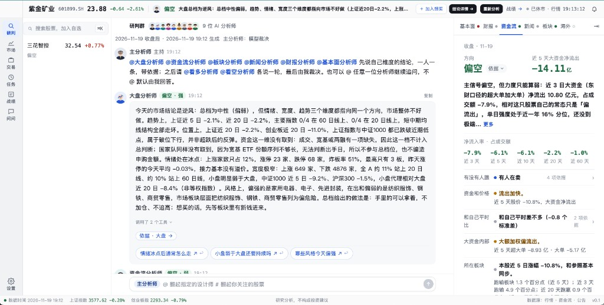
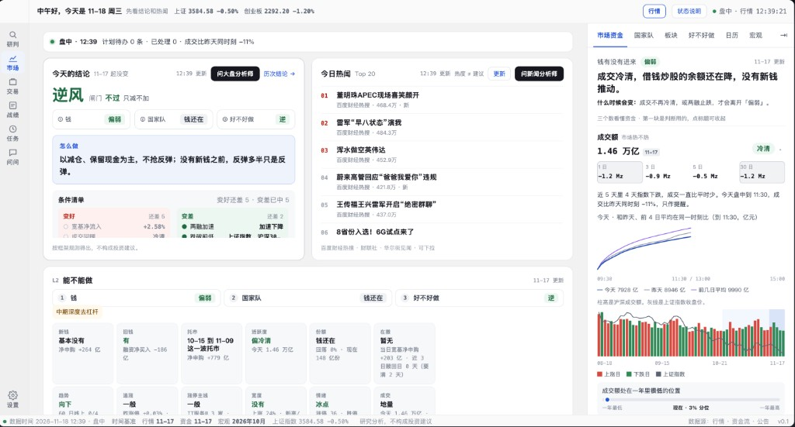
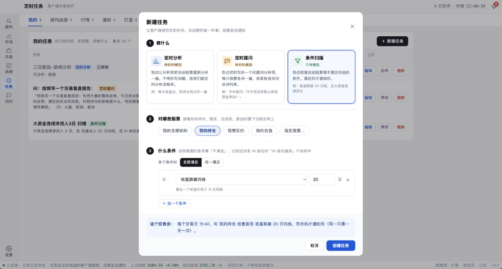
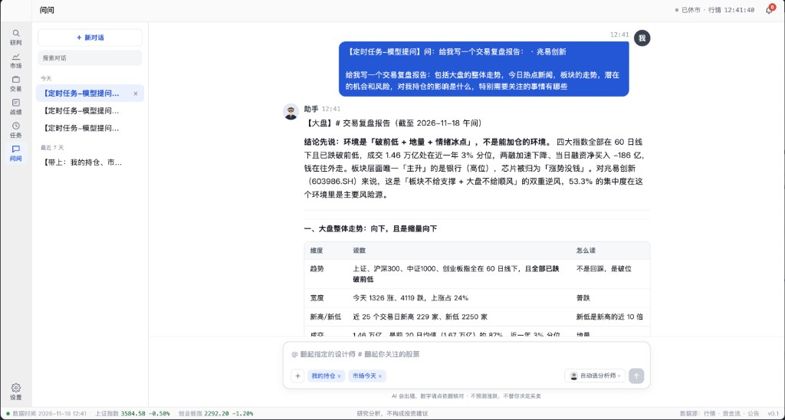

# 牛宝

把 A 股「研究晨会」搬到你自己的电脑上：多位分析师分席发言、看多看空对辩、主理人当场裁决；结论还能接到想买、持仓、交易计划和复盘，并用定时任务在收盘后替你续跑——最后用可结算的战绩打分，而不是停在一句观点。

**研究分析，不构成投资建议。**

<p align="center">
  
  <br />
  <em>研判晨会：分席发言 + 依据面板</em>
</p>

<p align="center">
  
  <br />
  <em>市场页：先看大势与热闻，再问大盘 / 新闻分析师</em>
</p>

---

## 为什么做牛宝

多数工具要么是资讯行情，要么是一个聊天框问「这只票怎么样」。  
真正做决策时缺的往往是另一套东西：

- 有没有人从不同维度把话说清楚，而不是一篇通稿？
- 看多和看空能不能当面辩，而不是只听一面？
- 分析完一只票，能不能直接放进购买清单，长期跟踪，而不是看完就散？
- 今天的判断，明天、下周还能不能核对对错？
- 想买的理由、持仓的理由，会不会悄悄过期？
- 人不盯盘的时候，谁来按点再看一眼？

牛宝按这条链路来设计。

---

## 五个特色

### 1. 一桌能对辩的多分析师晨会

打开一只股票的研判，像把投研晨会搬上桌：不是一个模型写一篇通稿，而是**分席位发言**。

资金流讲钱进没进、力度强不强；基本面和财报讲质地与最新一期数字；新闻讲近几日冲击消化了没有；板块讲它跟主线是同向还是自己走；大盘先把市场总档摆上桌——每人只说自己那一维，并且**带着可核对的依据**。

维度说完，**看多 / 看空**上场对辩：正方能站住的点、反方必须正视的风险，各列几条。最后由**主分析师裁决**：采信谁、不采信谁、为什么；并分别给「已经持有的人」和「还在观望想买的人」写清**条件式提醒**——什么条件下可以怎么想，条件变了做法就变，而不是一句「建议买入」。

晨会不是一次性 PDF。你随时可以 `@资金流`、`@财报` 继续追问；「问问」里是同一套班子，市场页上的「问大盘 / 问新闻」也能直接把人拉进对话。

### 2. 从心动到复盘的交易闭环

分析完最怕看完就散。牛宝把「观点」接到「动作与跟踪」上：

**刚看好一只票。** 晨会裁决后，一键放进**想买**：写下为什么心动、打算买多少。之后不是把票忘在收藏夹里——你会看到 AI 现在怎么看、理由还站不站得住，随时再跳回诊断。

**真金白银拿在手里。** **持有**里记每一笔，或导入券商持仓。列表不只给你盈亏，还对照：当初买入的理由是还成立、存疑，还是已经不成立；离改判还差什么。理由会过期，持仓页就是来盯这件事的。

**打算动手之前。** 把裁决落成当天的**交易计划**（买 / 卖 / 加 / 减、触发条件与理由），也可以手写。收盘标「已做」或「没做」——计划提前写，打开默认看今天，只记打算，不算成交。

**一天结束后。** **复盘**对照计划与实际：哪些执行了、哪些临阵改主意。把执行质量留下来，而不是只留下 K 线印象。

**周末或仓位发沉时。** 跑一次**仓位体检** / 找**持仓分析师**：钱压在哪几只、有没有同逻辑扎堆、质地有没有踩线、大盘再跌一截亏在哪；想买的放进现有组合合不合适。输出是按先后排序的待办，每条都是条件式做法。

整条链是：**研判 → 想买/持有 → 计划 → 复盘 → 再体检**，同一只票的上下文不断档。提醒始终是条件式的——副驾驶给预案，不是老师下命令。

### 3. 定时任务 + 消息通知：本机替你值班

人不盯盘的时候，最怕两件事：该看的时候没人看，看完了结果又沉在角落里。牛宝把**到点做事**和**把结果推到眼前**做成一件事。

**托盘常驻，关窗不停。** 关掉窗口只是藏起来，右键托盘才真正退出。开机可自启（可关）；电脑在，值班就在。

**到点替你跑。** 一边是系统任务（夜间研判、行情、盯盘、战绩结算等）；一边是你自己建的「我的任务」。自定义任务有三种模式，按你想省下的注意力来选：

| 模式 | 干什么 | 什么时候用 |
| --- | --- | --- |
| **定时分析** | 到点让分析师按固定流程重跑结论，并记成预测去跟踪 | 收盘后再看一遍持仓 / 想买，例如每个交易日 15:40 |
| **定时提问** | 到点把你写好的问题逐只问分析师，回答放进问问会话 | 午前扫一眼消息面，例如 11:00 问「有没有新公告或资金异动」 |
| **条件扫描** | 到点检查是否满足你设的条件，**满足才通知**（可不跑大模型） | 跌破 20 日线、大资金连出、盘中涨跌幅达标等；适合交易时段每 N 分钟盯一次 |

<p align="center">
  
  <br />
  <em>新建任务：选模式 → 选股票范围 → 设条件或问题；结果进通知</em>
</p>

范围可以是持仓、想买、全部标的，或你点名的几只票。定时分析 / 定时提问会用到你的模型 Key；条件扫描可以纯规则跑，更轻、更适合高频盯盘。

**结果进通知，而不是进空气。** 提醒、判断变化、战绩结算进收件箱，并弹出桌面通知；点一下回到对应页面。定时提问的回答会直接出现在「问问」会话里（带【定时任务】标记），夜里分析留下的方向还能进入战绩跟踪——值班不是发完消息就结束，而是接到可核对的下一环。

<p align="center">
  
  <br />
  <em>定时提问跑完后，复盘报告落在问问会话，可继续追问</em>
</p>

休眠、锁屏醒来后，会按策略补跑错过的任务（例如收盘复盘类会补；盘中瞬时提醒则不硬补），避免「睡一觉任务全断」。

### 4. 可结算的战绩，不只「感觉挺准」

留下的方向预测，会按 **5 个 / 20 个交易日**结算对不对，并能回看为什么错了。  
晨会好看，更要经得起对账。

### 5. 数据留在你的电脑上

模型 Key、持仓、意图、战绩写在本机。  
用你自己的 API Key 调用模型，不经过牛宝云端——适合不想把持仓交给在线助手的人。

---

## 分析师班子：谁擅长什么、什么时候找谁

研判晨会里，先由各位**维度分析师**发言，再由**看多 / 看空**对辩，最后**主分析师**裁决。  
问问里也可以 `@` 点名同一批人（看多 / 看空主要用在研判辩论里）。  
另外还有一位**持仓分析师**：不盯单票单维，而是把**一组股票放在一起**看（持仓体检或几只对比）。

### 维度分析师

| 分析师 | 看什么 | 典型使用场景 |
| --- | --- | --- |
| **大盘分析师** | 指数、资金、情绪、日历扰动等市场总档 | 开盘前问「今天好不好做」；个股裁决前先对齐大环境；市场页点「问大盘」 |
| **资金流分析师** | 大单/超大单净流入流出、力度、价资是否同向 | 短线异动、放量涨跌、想判断「钱在进还是在出」 |
| **基本面分析师** | 业务、估值分位、质量与股东行为等中长期底色 | 想买前做质地体检；持仓理由还在不在；和板块、估值对不上时 |
| **财报分析师** | 最新季报：营收/利润趋势、现金流、预期差 | 财报季前后；业绩预告/快报出来后；怀疑「利润好看但现金差」 |
| **新闻分析师** | 近几日公告与报道，是否已被价格消化、热度与风险 | 突发消息；热搜/舆情；市场页点「问新闻」做主题冲击梳理 |
| **板块分析师** | 主/次板块阶段、个股跟板块还是自己走、支撑还是拖累 | 板块轮动；个股大涨大跌时分不清是贝塔还是阿尔法 |

### 对辩与裁决

| 角色 | 做什么 | 典型使用场景 |
| --- | --- | --- |
| **看多分析师** | 从各位已有发言里抽出看多论据（短、带依据） | 晨会后半段；你觉得偏多但想听「正方能站得住的点」 |
| **看空分析师** | 对称地抽出看空论据 | 追高前泼冷水；持仓犹豫要不要减 |
| **主分析师** | 先读大盘总档，再综合六席与正反方，给出本轮裁决与条件式提醒 | 晨会收束；生成交易计划 / 写入想买前的「主持人结论」 |

### 持仓分析师（看组合，不看单席）

别的分析师各看一只股票的一个方面；主分析师给一只股票下裁决。  
**持仓分析师**看的是一组票放在一起：

| 模式 | 做什么 | 典型使用场景 |
| --- | --- | --- |
| **持仓体检** | 钱压在哪、哪几只其实是同一逻辑、最坏情形亏在哪；按先后给出待办；想买的放进现有组合合不合适 | 持仓页做仓位体检；周末想理清「现在最该先处理什么」 |
| **股票对比** | 对比 2～6 只：走势位置、质地、AI 态度、板块与联动；说清能比/不能比，谁先看 | 「这两只怎么选」「同样看好，先看哪只」；问问里让主理人调用对比 |

### 怎么协作（场景）

- **刚盯上一只票**：开研判，让维度分析师先说完 → 看多看空 → 主分析师裁决 → 「加入想买」长期跟踪  
- **只想问一件事**：去问问，`@资金流` / `@财报` / `@新闻` 等，不必整场晨会  
- **先看大势再选股**：市场页问大盘 / 新闻，再落到具体股票研判  
- **已经持有 / 多只一起看**：持仓体检或对比几只；单票存疑再拉回对应维度或重开晨会  

每位分析师的结论都尽量带**依据**（可点开核对），强度有强/弱之分；弱信号也会直说「没什么可讲的」，而不是硬凑故事。

---

## 你怎么用

打开后默认在**市场**：看资金、板块、日历，顺手问大盘或新闻分析师。  
盯上某只票，进**研判**开一轮晨会；有结论后，可进**持仓**写成想买或交易计划。  
人不在时交给**任务**；过几天来**战绩**看判对了没有。

快捷键：`⌘/Ctrl+1` 市场 · `+2` 研判 · `+3` 问问 · `+4` 个人工作区。

---

## 开始使用

**安装包（推荐试用）**  
用发布页或本地 `make mac` / `make win` 打出的安装包（产物在 `native/dist/`）。首次打开填入你自己的模型 API Key 即可。macOS 若未签名，需在 Finder 里右键「打开」一次。

**从源码跑（开发者）**

```sh
cp web/config.example.yaml web/config.yaml   # 填入 llm.api_key，勿提交真 Key
cd native && make start
```

开发联调、打包与托盘细节见 [`native/README.md`](native/README.md)；服务与 Agent 细节见 [`web/README.md`](web/README.md)。

---

## 现状说明

- 主场景面向 **A 股**
- 需要你自己的 **大模型 API**（首版对接 DeepSeek 系）
- 安装包体积较大（自带运行环境，免去本机装一堆工具链）
- 分析会错；市场有风险；盈亏自负

---

## 贡献与许可

欢迎 Issue / PR：修体验、补文档、打磨晨会与交易闭环。大改动建议先开 Issue。

开源许可证待选定后补充 `LICENSE`。许可明确前，请勿默认视为可任意商用。

---

## 免责声明

牛宝提供的信息与分析结果仅供研究与学习，**不构成任何投资建议或收益承诺**。证券市场有风险，决策与盈亏由使用者自行承担。
